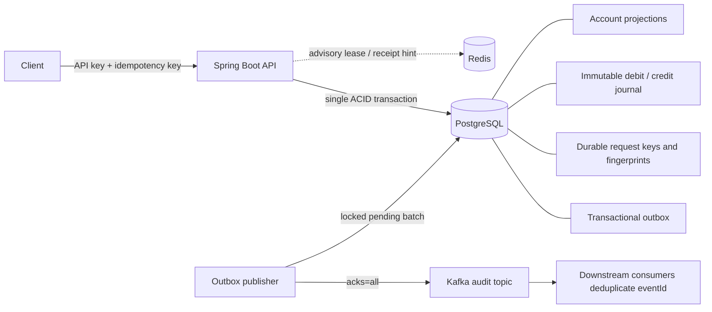

# Architecture and correctness model

## One transaction, one source of truth

1. Validate the request and derive a canonical SHA-256 fingerprint from operation, account IDs, amount, and currency. The API accepts integer minor units only.
2. Optionally acquire a Redis lease and read a receipt hint. A hint is only valid if PostgreSQL confirms both its ID and the request key; a hint never bypasses the stored fingerprint check. Failure to acquire the advisory lease does not reject the request.
3. Insert the transfer using a unique request key with `ON CONFLICT DO NOTHING`. PostgreSQL waits for any conflicting transaction. After the winner commits, the loser reads the original receipt; mismatched fingerprints return `409`. A rolled-back winner leaves no key reservation.
4. Lock both account rows in ascending UUID order using `FOR NO KEY UPDATE`. This is a pessimistic write lock that conflicts with competing balance writers but remains compatible with foreign-key `KEY SHARE` locks acquired by transfer inserts. Using `FOR UPDATE` after those FK locks could introduce lock-upgrade deadlocks under contention.
5. Check account kind, currency, funds, and overflow. Insert the debit and credit. Database triggers update account projections in the same transaction and nonnegative checks reject customer overdrafts.
6. Insert an outbox event. At commit, a deferred constraint trigger proves the exact pair of postings matches the transfer amount and accounts. Any failure rolls back **everything**, including the key reservation.
7. After the transaction commits, populate the Redis hint and return the original receipt. A lost HTTP response can be recovered with the same request key.

READ COMMITTED plus explicit ordered row locks is sufficient for this two-account balance invariant. Reconciliation uses one statement and therefore one consistent MVCC snapshot. Transactions hold locks for bounded work; the database statement timeout is 15 seconds. Deadlock/lock failures surface as retryable errors. Callers must retry with the same key, applying backoff rather than minting a new key.

## Accounting convention

Customer deposits are bank liabilities: CREDIT increases the customer's balance, DEBIT decreases it. A customer-to-customer payment debits the sender liability and credits the beneficiary liability. Simulated external funding debits a technical clearing account and credits the customer's liability. The technical clearing account is allowed negative balances to represent the external side of this limited demo chart of accounts. This is not a complete bank balance sheet, general ledger, or external settlement adapter.

Every transfer has exactly two immutable entries, equal magnitude and opposite side. All accounts start at zero. Consequently:

- Sum of signed postings per transfer = 0.
- Each account's stored balance = sum of its credits minus debits.
- Global balance sum = 0, including clearing.

The API cannot edit balances directly. Trigger-based projections remove application dual writes, but privileged direct edits to `accounts` are still possible with the demo owner role and will appear as reconciliation drift. Real deployments should grant the runtime role only tightly scoped operations and separate Flyway migration credentials.

## Kafka contract and failure windows

The publisher locks up to 50 pending events with `FOR UPDATE SKIP LOCKED`, sends each with its transfer ID as Kafka key, waits for broker acknowledgement, and marks it published in the database transaction. Failed batches roll back published markers and are retried on subsequent runs. Kafka producer idempotence helps within a producer session but does not eliminate outbox retry duplicates.

| Failure | Expected outcome |
|---|---|
| Client loses successful response | Same key returns committed receipt |
| Concurrent identical requests | One journal; all others replay |
| Same key with changed amount/accounts | 409; no additional journal |
| Concurrent overspending | Row locks serialize; insufficient requests roll back |
| Redis unavailable or lease expires | PostgreSQL still provides correctness |
| Database/outbox insert fails | Entire transfer rolls back |
| Kafka offline | Transfer commits; pending event remains |
| Crash after Kafka ack, before DB commit | Event can be delivered again with the same eventId |
| Database unavailable | No transfer accepted |

This is **at-least-once event delivery**, not end-to-end exactly-once processing. Downstream consumers must store processed `eventId` values with their side effects in a local transaction. `schemaVersion: 1` permits explicit future event evolution. Consumers must not infer strict account-wide ordering from a topic keyed by transfer ID; cross-transfer account ordering is not promised. A poison event can delay a batch; production systems need bounded retry metadata and an operator workflow.

## Security and operations

The API key authenticates a trusted internal service and grants full demo access. There is no customer ownership model, user login, maker/checker authorization, or public deposit integration. Stateless header authentication disables CSRF because no browser cookie session is accepted. Do not expose the development stack publicly. Never put keys in URLs, request examples, or committed configuration.

`/actuator/health` checks application/database availability. Optional Redis failure is excluded from health. Kafka delivery is monitored through `pending_events`, not health; a healthy app can have a stalled audit pipeline. `/api/v1/reconciliation` is intentionally a full scan for the small demo dataset and would require an incremental/restricted workflow at institutional scale.

Recovery requires backing up the PostgreSQL journal, transfer keys, and outbox together; recreating Redis is safe. Real operations require a tested backup/PITR policy, reconciliation against external rails, and alerting on stale outbox rows and nonzero drift. Journal corrections should be compensating transfers with new idempotency keys; no deletion endpoint exists.
